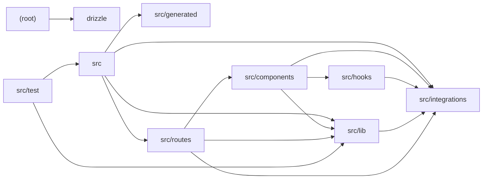

# Architecture

A TanStack Start (Vite + React) travel-assistant web app for Denmark. The root module holds tooling configuration (Drizzle, ESLint, Vite, Vitest); `src` wires the router, server fetch handler, and Start instance with CSRF, error, and Supabase auth middleware. `src/routes` defines public guide pages, auth flows, and authenticated AI chat/planner features, composing UI from `src/components` (Radix/Tailwind primitives plus ai-elements chat components) and calling into `src/lib`, which contains the AI touchpoints: streaming chat via @lovable.dev/ai-gateway, structured trip-plan generation, and hybrid RAG retrieval with Gemini embeddings. `src/integrations` provides Supabase/Lovable clients, auth middleware, cron auth, and DB types; `src/hooks` supplies session and viewport hooks; `src/generated` holds AI gateway model type augmentations; `src/test` covers routing, currency math, and knowledge scoring; `drizzle` is a currently empty schema placeholder.

## Modules

| module | summary | AI |
| --- | --- | --- |
| `(root)` | Tooling configuration for Drizzle migrations, ESLint/Prettier, Vite/TanStack Start bundling, and Vitest. | — |
| `drizzle` | Auto-generated, currently empty Drizzle ORM schema placeholder. | — |
| `src` | Client router factory, server fetch handler with error-page normalization, and Start instance with CSRF/error/auth middleware. | — |
| `src/components` | Radix/Tailwind UI primitives, site layout components, and ai-elements chat components (conversation, message, prompt input, shimmer). | [AI] |
| `src/generated` | Generated module augmentations mapping AI gateway model identifiers to capability surfaces. | [AI] |
| `src/hooks` | React hooks for mobile viewport detection and Supabase session tracking with router invalidation. | — |
| `src/integrations` | Lovable OAuth wrapper, Supabase auth-attaching middleware, cron token validation, and DB schema types. | — |
| `src/lib` | Server/client utilities: streaming AI chat, trip-plan generation, hybrid RAG retrieval, static knowledge/cities data, currency math, error telemetry, and cn helper. | [AI] |
| `src/routes` | File-based routes for guides, auth, authenticated AI chat and planner views, and the /api/chat server endpoint. | [AI] |
| `src/test` | Vitest suites for route matching, currency conversion, and knowledge scoring plus DOM test setup. | — |

## Module dependencies

_`[AI]` marks modules with AI/LLM touchpoints (prompt files, model API calls, agent logic)._
