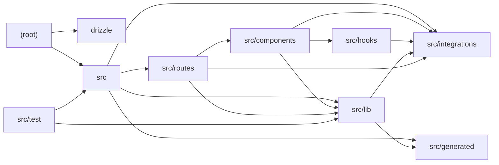

# Architecture

Hej Copenhagen is a TanStack Start (React + TanStack Router + React Query) travel-guide application for Denmark, built with Vite and backed by Supabase for auth and persistence. Static guide content (visas, currency, cities, people, history) lives in src/lib data modules and is rendered by file-based routes in src/routes. The AI layer is powered by @lovable.dev/ai-gateway: src/lib/chat.server.ts streams RAG-grounded chat responses (gpt-6-astra) using embeddings from rag.server.ts (gemini-embedding-2) over a static knowledge base, while planner.functions.ts generates structured trip itineraries via a server function. Generated type augmentations in src/generated constrain the allowed model IDs. The presentation layer is a shadcn-style design system of Radix-based UI primitives plus Vercel-AI-SDK-aware 'ai-elements' (conversation, message, prompt input, shimmer). Cross-cutting concerns—CSRF, error normalization, Supabase bearer-token attachment—are configured as middleware in src/start.ts and src/server.ts. Drizzle ORM config exists at the root but the schema is currently an empty placeholder; Vitest covers routing, currency math, and knowledge retrieval.

## Modules

| module | summary | AI |
| --- | --- | --- |
| `(root)` | Build, lint, test, and Drizzle migration configuration for the TanStack Start app. | — |
| `drizzle` | Auto-generated (currently blank) Drizzle ORM schema placeholder. | — |
| `src` | App bootstrap: router factory, custom server fetch handler, CSRF/error/auth middleware, and AI gateway type imports. | — |
| `src/components` | Radix/Tailwind UI primitive design system, shared layout elements, and AI chat UI elements. | [AI] |
| `src/generated` | Type augmentations for @lovable.dev/ai-gateway enumerating allowed model IDs per surface. | [AI] |
| `src/hooks` | Client hooks for mobile viewport detection and Supabase session tracking. | — |
| `src/integrations` | Supabase types and auth middleware, Lovable Cloud OAuth, and cron-secret request authentication. | — |
| `src/lib` | Domain data (cities, currency, knowledge), RAG retrieval, streaming AI chat and trip-planner server logic, and error/styling helpers. | [AI] |
| `src/routes` | File-based TanStack Router pages and API endpoints for guide content, auth, AI chat, and trip planning. | [AI] |
| `src/test` | Vitest setup and suites for routing, currency conversion, and knowledge search. | — |

## Module dependencies

_`[AI]` marks modules with AI/LLM touchpoints (prompt files, model API calls, agent logic)._
