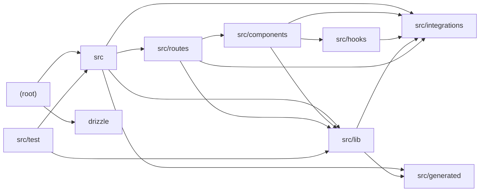

# Architecture

Hej Copenhagen is a TanStack Start + React travel-guide site for Denmark with an AI travel assistant. The root tooling (Vite via Lovable's TanStack preset, Drizzle Kit, ESLint, Vitest) wraps an application bootstrap in src/ that builds the router with a React Query client, registers request middleware (error page rendering, CSRF) and a client function middleware that attaches the Supabase bearer token to server-function RPCs. File-based routes in src/routes serve static content pages (visa, currency, cities, people, history), a Supabase/Lovable OAuth auth page, and an authenticated layout guarding the AI chat and AI trip planner. AI logic is concentrated in src/lib: chat.server.ts streams replies through the Lovable AI gateway (openai/gpt-6-astra) grounded by a hybrid keyword/embedding RAG layer (rag.server.ts, knowledge.ts, google/gemini-embedding-2), and planner.functions.ts generates structured JSON itineraries, both persisted to Supabase (chat_messages, trips). src/generated holds type-only augmentations listing allowed gateway model IDs. src/components provides a shadcn/Radix primitive library, AI chat building blocks (conversation, message, prompt input, shimmer), and site chrome; src/hooks supplies mobile detection and Supabase session tracking; src/integrations wires Supabase clients, generated DB types, Lovable OAuth and cron-secret validation. The drizzle/ schema is an intentionally blank generated stub, and src/test covers routing, currency helpers and knowledge-base keyword retrieval.

## Modules

| module | summary | AI |
| --- | --- | --- |
| `(root)` | Build, lint, test and Drizzle migration configuration for the project. | — |
| `drizzle` | Intentionally blank auto-generated Drizzle ORM schema stub. | — |
| `src` | App bootstrap: router with React Query context, Start instance with error/CSRF/Supabase-auth middleware, and custom SSR error-handling server entry. | — |
| `src/components` | shadcn/Radix UI primitives, AI chat UI elements (conversation, message, prompt input, shimmer) and site chrome. | [AI] |
| `src/generated` | Type-only augmentation of @lovable.dev/ai-gateway listing permitted model IDs per surface. | [AI] |
| `src/hooks` | useIsMobile viewport hook and useSession Supabase auth-session hook with router invalidation. | — |
| `src/integrations` | Supabase clients and generated DB types, Lovable OAuth wrapper, bearer-token function middleware and cron-secret validation. | — |
| `src/lib` | Static content, hybrid RAG knowledge retrieval, streaming AI chat handler, AI trip-planner server function, error and UI utilities. | [AI] |
| `src/routes` | File-based routes: root shell, static pages, auth page, authenticated chat/planner pages and POST /api/chat streaming endpoint. | [AI] |
| `src/test` | Vitest suite for routing, currency conversion and knowledge keyword search, plus jsdom setup. | — |

## Module dependencies

_`[AI]` marks modules with AI/LLM touchpoints (prompt files, model API calls, agent logic)._
